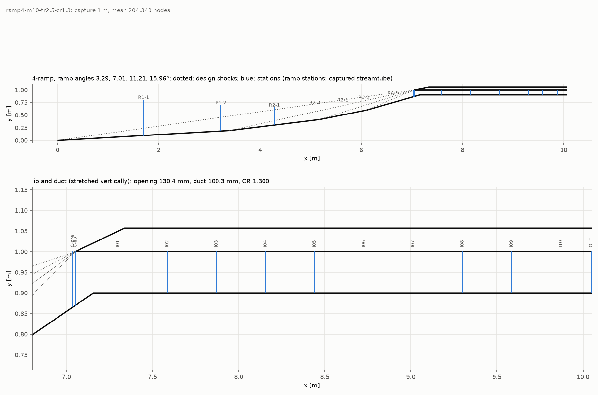
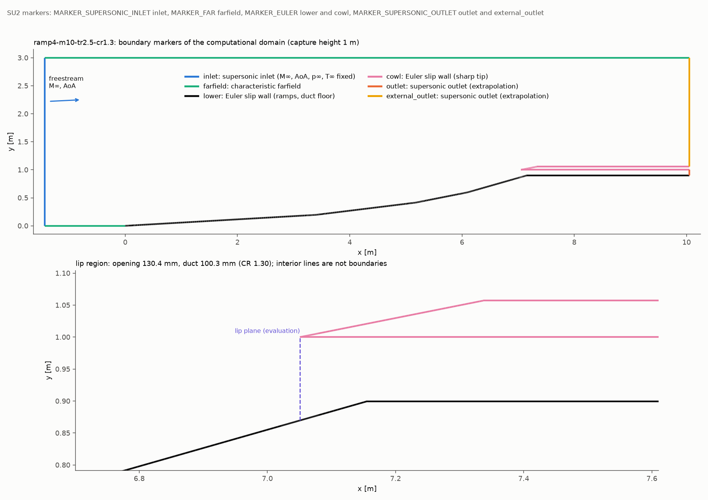
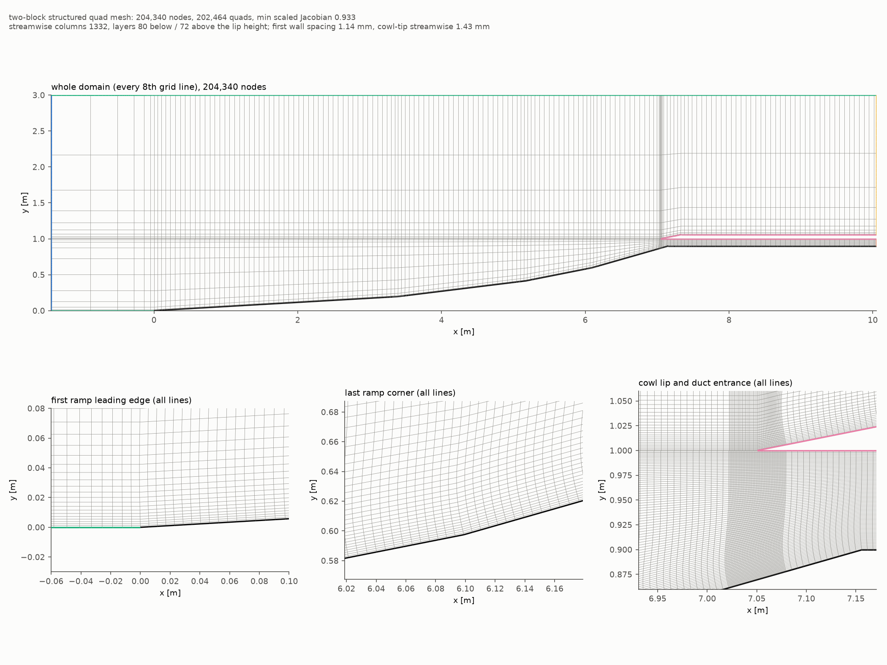
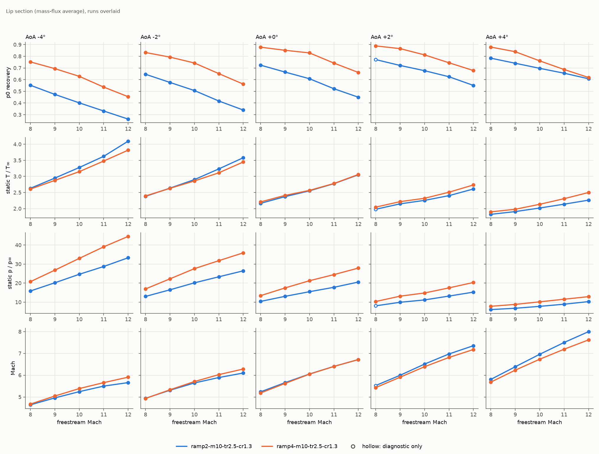
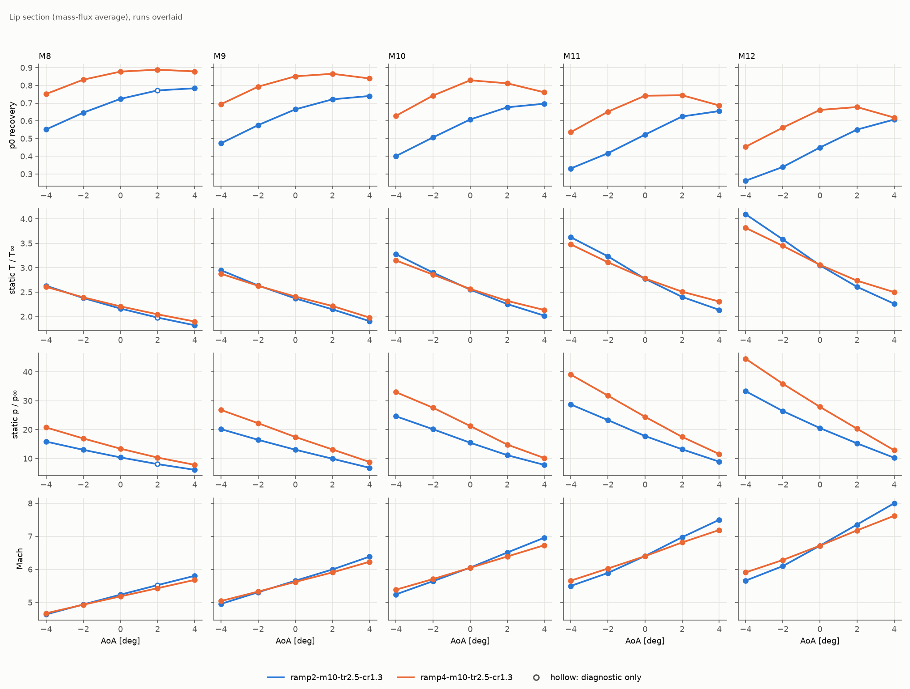
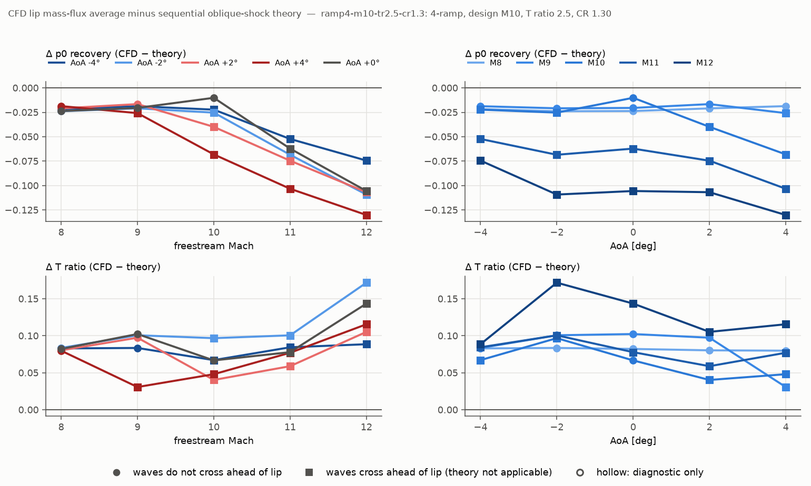
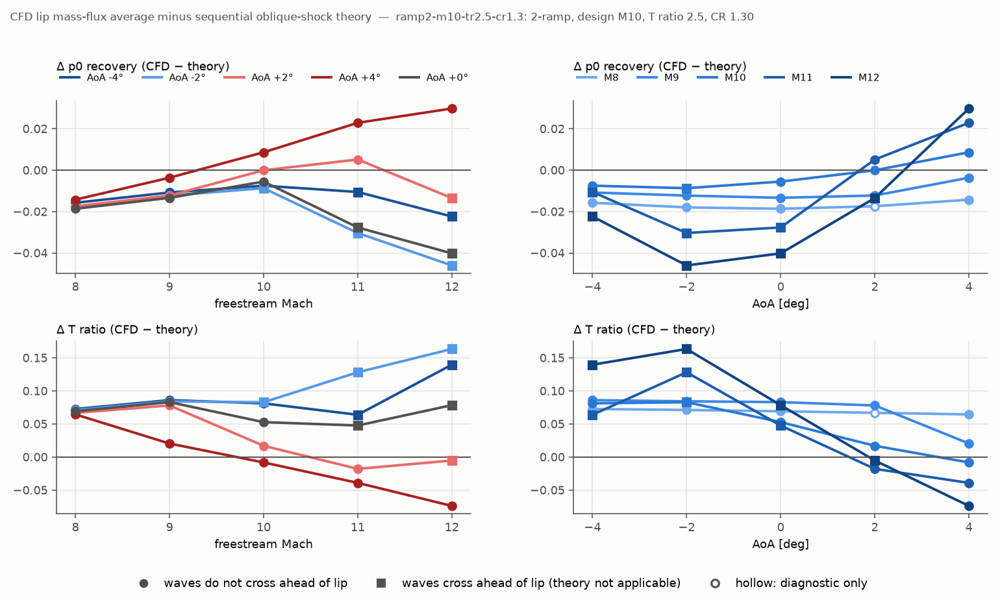

# 2段・4段Eulerインテーク：設計Mach 10のマッハ数・迎角掃引（リップ断面）

2026年10月24日実行。ワークステーション用に整備した[掃引スクリプト](../../intake-euler/intake-sweep-pbs.md)を、Mac mini（12 MPI、ローカル実行）で全ケース流した記録である。前回の4段のオフデザイン掃引（10/13、非公開）と同じ数値設定・受入判定・評価方法を使い、2段ランプを加えた。

## 結論

- 50ケース中49ケースが受入（うち3ケースは自動のやり直しで受入）。全ケースでリップ手前の始動を確認した。2段の Mach 8・+2° だけ、残差が4.4桁で止まり受入にならなかった（リップ値の変化は1e-13で、値は止まっている）。
- リップ断面の総圧回復率は、全条件で4段が2段より高い。設計点（Mach 10・0°）で4段0.829、2段0.608。差は負の迎角で大きく（Mach 8・−4°で0.20）、正の迎角・高Machで縮む（Mach 12・+4°で0.619と0.608）。
- 静温比は迎角0°では両形状でほぼ同じ（設計点で4段2.57、2段2.55、設計値2.5）。負の迎角では2段が、正の迎角では4段が高い。静圧比は全条件で4段が高い。
- 4段は10/13の形状を1/0.35倍に拡大したもの（収縮比だけ1.141→1.3）。リップ断面の値は10/13とほぼ一致した（Mach 8・0°で0.878対0.879、Mach 10・0°で0.829対0.828、Mach 12・0°で0.662対0.662）。収縮比の変更はリップ断面の値に影響しない。
- 理論式（逐次斜め衝撃波）との差：衝撃波がリップ手前で交差しない条件では、CFDの総圧回復率が0〜0.024低い（数値誤差の範囲）。交差する条件では、4段で最大0.13、2段で最大0.046低い。2段の高Mach・正の迎角では逆に最大0.03高い。詳細は[理論式だけでは分からないこと](#理論式だけでは分からないこと)。
- リップ面の全温誤差（質量流束平均）は0.07%以下で、その大部分はカウル先端の1節点から来る。

## 共通条件

| 項目 | 内容 |
|---|---|
| 設計 | 定比熱、設計Mach 10、ランプ後静温比2.5、等強度の衝撃波配分、shock-on-lip、捕獲高さ1 m、鋭角カウル（先端半径0） |
| 流路 | 収縮比1.3（リップ開口÷流路高さ）。最終ランプをリップより下流へ延長して流路高さを決める。流路長はリップから出口まで3 m |
| 格子 | 二ブロック構造四角形。節点列は規則で作り、10/11のfine-quadと同じ相対解像度（length_scale = 1/0.35）。カウル厚さ0.057 m、先端長さ0.286 m、上流1.43 m |
| 気体・一様流 | 定比熱理想気体Euler、γ=1.4、R=287.05 J/(kg K)、220 K、2500 Pa。結果は無次元で、高度に依存しない |
| 境界 | 超音速流入口（速度はAOAと一致）、farfield、ランプ・カウルはEuler滑り壁、内外の出口は超音速外挿 |
| 数値 | SU2 8.5.0、HLLC、MUSCL、WLS、Venkatakrishnan K=0.05、陰的Euler、FGMRES/ILU、MG 0、CFL 1、12 MPI・OMP 1、同時1ケース |
| 手順 | 一様流から一次精度1000反復、その解から二次精度（最大4万反復、2000反復ごとに保存）。受入しなければ自動でやり直す：失敗→limiterの固定を10000反復目に遅らせる→CFL 0.5、未達→最後の保存点からlimiterの固定を遅らせて続ける（二次精度は最大4回） |
| 受入 | 非物理点ゼロ、密度・エネルギー残差が一次精度開始時から5桁低下、開境界の質量・エネルギー収支0.1%以内、リップ面と上流面（14.3 mm上流）の5量の2000反復間変化0.01%未満、二次精度6000反復以上 |
| 始動 | 上流面に逆流がなく、亜音速の流量が1%未満 |
| 評価 | リップ面（x=リップ先端、ランプ壁からリップ高さまで）。順方向の質量流束で重み付けした平均（5点Gauss）。ミックスアウト平均は質量・x/y運動量・エネルギーの流束を保存する一様状態 |
| 掃引 | Mach 8、9、10、11、12 × 迎角 −4、−2、0、+2、+4°（SU2の符号。+αで圧縮が弱まる） |

| 形状 | ランプ角 | ランプ長 | リップ開口 | 流路高さ | 格子 | 設計点の理論p0 |
|---|---|---:|---:|---:|---:|---:|
| 4段 | 3.29、7.01、11.21、15.96° | 7.05 m | 130.4 mm | 100.3 mm | 204,340節点 | 0.839 |
| 2段 | 6.34、14.43° | 5.27 m | 177.1 mm | 136.2 mm | 168,692節点 | 0.613 |

### 境界条件と格子

計算領域は、第1ランプ先端の1.43 m上流から出口（リップの3 m下流）まで、高さ3 m（捕獲高さの3倍）。上流の床（y=0、x<0）と上端はfarfield、左端は超音速流入口、ランプ・流路の床とカウルの内外面はEuler滑り壁、流路出口とカウル外側の出口は超音速流出口。リップ面（評価断面）は境界ではなく内部の線である。

格子は二ブロック構造四角形で、下ブロックは床からリップ高さまで80層、上ブロックはリップ高さ（下流ではカウル外面）から上端まで72層。流れ方向の節点列は、ランプ・流路で8.6 mm、ランプの角とリップ付近で5.7 mm、カウル先端の前後29 mmで1.43 mm（いずれも10/11のfine-quadの3 mm・2 mm・0.5 mmを1/0.35倍したもの）。壁の第一層は最大1.14 mm。ランプの角では、壁に垂直な格子線を滑らかにつないでいる。先端は丸めていない。

2段の図：[境界条件](figures/ramp2-boundary-conditions.png)、[格子](figures/ramp2-mesh.png)（168,692節点、最小scaled Jacobian 0.940）。4段は204,340節点、最小scaled Jacobian 0.933。

## 解析手法

設定値は実行したcfg（例：[4段 Mach 10・0°の二次精度段](configs/ramp4/m10_a+0/second.cfg)）から写した。一次精度段との違いは `MUSCL_FLOW`、`RESTART_SOL`、`ITER`、保存間隔だけである。

### 支配方程式と気体

| 項目 | 内容 | cfg |
|---|---|---|
| 方程式 | 二次元の圧縮性Euler方程式（非粘性、断熱）。定常解を擬似時間進行で求める | `SOLVER= EULER` |
| 気体 | 熱量的完全気体。γ=1.4、R=287.05 J/(kg K) | `FLUID_MODEL= IDEAL_GAS` |
| 単位 | 有次元（SI）で解く。一様流は220 K、2500 Pa。結果は一様流の値で割って無次元で示す | `REF_DIMENSIONALIZATION= DIMENSIONAL` |
| ソルバー | SU2 8.5.0（改変なし） | |

### 空間離散化

| 項目 | 内容 | cfg |
|---|---|---|
| 有限体積法 | 節点中心（vertex-based）。SU2が各節点のまわりに中線双対の検査体積を作り、辺ごとに数値流束を評価する。格子は構造四角形だが、SU2には非構造格子として渡す | |
| 対流流束 | HLLC近似Riemannソルバー | `CONV_NUM_METHOD_FLOW= HLLC` |
| 二次精度化 | MUSCL再構成。節点の勾配を使い、辺の中点で左右の状態を線形に再構成する。一次精度段では再構成しない（区分一定） | `MUSCL_FLOW= YES / NO` |
| 勾配 | 重み付き最小二乗（WLS）。再構成用の勾配も同じ | `NUM_METHOD_GRAD`、`NUM_METHOD_GRAD_RECON` |
| 制限関数 | Venkatakrishnan、係数K=0.05。衝撃波の付近では再構成の傾きを抑え、一次精度に近づく | `SLOPE_LIMITER_FLOW`、`VENKAT_LIMITER_COEFF` |
| 制限関数の固定 | その段の1500反復目（やり直しでは10000反復目）以降、制限関数の値を固定する。固定しないと、衝撃波付近で制限関数の値が切り替わり続け、残差が下がりきらないため | `LIMITER_ITER` |

精度の目安：滑らかな領域では二次精度、衝撃波は数セルの厚みで捉える。衝撃波のすぐ近くでは制限関数のため一次精度に近い。

### 時間進行（擬似時間）と線形ソルバー

| 項目 | 内容 | cfg |
|---|---|---|
| 時間積分 | 陰的Euler法（後退Euler）。各節点で局所時間刻みを使い、定常解へ進める | `TIME_DISCRE_FLOW= EULER_IMPLICIT` |
| CFL数 | 1.0で固定（適応なし）。やり直しの一部では0.5 | `CFL_NUMBER`、`CFL_ADAPT= NO` |
| 線形方程式 | 毎反復の線形化した方程式をFGMRESで解く。前処理はILU、相対残差0.01か20回で打ち切る | `LINEAR_SOLVER`、`LINEAR_SOLVER_PREC`、`LINEAR_SOLVER_ERROR`、`LINEAR_SOLVER_ITER` |
| マルチグリッド | 使わない | `MGLEVEL= 0` |
| 並列 | MPI 12プロセス、OpenMP 1スレッド（Mac mini） | |

### 境界条件

| 境界 | 条件 | cfg |
|---|---|---|
| 左端（inlet） | 超音速流入。静温・静圧・速度の2成分（迎角の向き）を全て与える | `MARKER_SUPERSONIC_INLET` |
| 上端と、第1ランプより上流の床（farfield） | 特性線に基づく遠方境界。一様流の状態を外部の値として与える | `MARKER_FAR` |
| ランプ・流路の床（lower）、カウルの内外面（cowl） | Euler滑り壁。壁を通る流れはなく、壁の流束は圧力の項だけ | `MARKER_EULER` |
| 流路出口（outlet）、カウル外側の出口（external_outlet） | 超音速流出。全ての量を内部から外挿する。全ケースで出口の法線Machが1を超えることを確認した | `MARKER_SUPERSONIC_OUTLET` |

### 初期化・段の進め方・停止

1. **一次精度段**：一様流（迎角の向き）から、MUSCLなしで1000反復。
2. **二次精度段**：一次精度段の解から、MUSCLありで最大4万反復。初期解はSU2 8.5.0のパス長の問題を避けるため、段のフォルダへ短い名前で写してから読み込む。
3. **停止**：SU2の収束判定は使わない（`CONV_STARTITER`を`ITER`より大きくして無効にする）。2000反復ごとの保存点で、スクリプトが受入判定（[共通条件](#共通条件)の表）を評価する。満たした時点でソルバーを止め、その保存点を結果とする。このため、受入した段のSU2の終了コードは停止信号による1である。
4. **自動のやり直し**：非物理点・発散・異常終了なら、制限関数の固定を遅らせる、次にCFLを下げる。健全だが判定に届かなければ、最後の保存点から制限関数の固定を遅らせて続ける。二次精度は1ケース最大4回。

### 後処理（リップ断面などの評価）

| 項目 | 方法 |
|---|---|
| 断面上の値 | 各四角形を2つの三角形に分け、その中で保存変数（密度、運動量、全エネルギー）を線形補間する。断面と格子線の交点で区間に分け、各区間を5点Gauss–Legendreで積分する |
| 物理量 | 保存変数から静圧・静温・Machを求め、全圧・全温は等エントロピーの関係から求める |
| 平均 | 順方向（x方向）の質量流束で重み付けした平均。逆流分は別に記録する |
| ミックスアウト平均 | 断面の質量・x運動量・y運動量・エネルギーの流束を保存する一様状態（超音速の解） |
| 分布の幅 | 質量流束で重み付けした5%・50%・95%値 |
| 一様流のまま入る流量 | 総圧回復率と静温比がともに一様流から0.5%以内の流れの割合 |
| ランプ断面 | リップ面と同じ流量を運ぶ壁側の流管で平均する |
| 始動 | リップの14.3 mm上流の面に逆流がなく、亜音速の流量が1%未満 |
| 理論値 | ランプ面に沿った逐次一様の斜め衝撃波（負の転向はPrandtl–Meyer膨張）。直線の衝撃波を延ばし、リップ手前での交差を判定する |
| Kantrowitz | 理論のリップMachで、垂直衝撃波の後に等エントロピー収縮でM=1になる面積比 |

スクリプトは[掃引の説明](../../intake-euler/intake-sweep-pbs.md)にあり、断面の積分は`scripts/intake_section.py`、平均と判定は`scripts/intake_sweep_metrics.py`、理論は`scripts/intake_sweep_theory.py`。10/13の保存場で、断面の評価が当時の記録の値（リップ総圧回復率0.82757など）を再現することを確認した。

## 実行したケースと結果

全ケースを実行した（計画との違いはない）。各ケースの全段の設定は[case-settings.csv](case-settings.csv)、試行ごとの記録は[execution.csv](execution.csv)、全列は[ramp4-lip-results.csv](ramp4-lip-results.csv)と[ramp2-lip-results.csv](ramp2-lip-results.csv)。表のp0は総圧回復率の質量流束平均、「差」はCFD−理論、「交差」は理論の直線衝撃波がリップ手前で交差するか。設定は実行した最後の二次精度段のcfg（格子と初期解はファイル名だけ）。

| 形状 | case | Mach | 迎角 [°] | 判定 | 用途 | 二次精度の試行 | p0回復率 | p0（ミックスアウト） | p0の5–95% | 静温比 | 静圧比 | Mach | 流量捕獲率 | 理論p0 | 差 | 交差 | 設定 |
|---|---|---:|---:|---|---|---:|---:|---:|---|---:|---:|---:|---:|---:|---:|---|---|
| 4段 | m08_a-4 | 8 | -4 | qualified | performance | 1 | 0.752 | 0.730 | 0.75–0.79 | 2.608 | 20.8 | 4.68 | 0.917 | 0.774 | -0.022 | なし | [cfg](configs/ramp4/m08_a-4/second.cfg) |
| 4段 | m08_a-2 | 8 | -2 | qualified | performance | 1 | 0.833 | 0.804 | 0.83–0.87 | 2.394 | 16.9 | 4.93 | 0.821 | 0.856 | -0.024 | なし | [cfg](configs/ramp4/m08_a-2/second.cfg) |
| 4段 | m08_a+0 | 8 | +0 | qualified | performance | 1 | 0.878 | 0.844 | 0.88–0.91 | 2.209 | 13.4 | 5.19 | 0.709 | 0.902 | -0.024 | なし | [cfg](configs/ramp4/m08_a+0/second.cfg) |
| 4段 | m08_a+2 | 8 | +2 | qualified | performance | 1 | 0.889 | 0.850 | 0.89–0.92 | 2.047 | 10.3 | 5.43 | 0.592 | 0.910 | -0.021 | なし | [cfg](configs/ramp4/m08_a+2/second.cfg) |
| 4段 | m08_a+4 | 8 | +4 | qualified | performance | 1 | 0.879 | 0.836 | 0.88–0.92 | 1.899 | 7.8 | 5.68 | 0.484 | 0.898 | -0.019 | なし | [cfg](configs/ramp4/m08_a+4/second.cfg) |
| 4段 | m09_a-4 | 9 | -4 | qualified | performance | 1 | 0.694 | 0.670 | 0.69–0.73 | 2.877 | 26.8 | 5.05 | 1.076 | 0.713 | -0.019 | なし | [cfg](configs/ramp4/m09_a-4/second.cfg) |
| 4段 | m09_a-2 | 9 | -2 | qualified | performance | 1 | 0.793 | 0.761 | 0.79–0.83 | 2.630 | 22.2 | 5.33 | 0.982 | 0.814 | -0.021 | なし | [cfg](configs/ramp4/m09_a-2/second.cfg) |
| 4段 | m09_a+0 | 9 | +0 | qualified | performance | 1 | 0.851 | 0.811 | 0.84–0.89 | 2.410 | 17.5 | 5.62 | 0.845 | 0.872 | -0.021 | なし | [cfg](configs/ramp4/m09_a+0/second.cfg) |
| 4段 | m09_a+2 | 9 | +2 | qualified | performance | 1 | 0.866 | 0.819 | 0.86–0.91 | 2.217 | 13.2 | 5.91 | 0.696 | 0.882 | -0.017 | なし | [cfg](configs/ramp4/m09_a+2/second.cfg) |
| 4段 | m09_a+4 | 9 | +4 | qualified | performance | 1 | 0.839 | 0.785 | 0.67–0.89 | 1.980 | 8.8 | 6.23 | 0.530 | 0.865 | -0.026 | あり | [cfg](configs/ramp4/m09_a+4/second.cfg) |
| 4段 | m10_a-4 | 10 | -4 | qualified | performance | 1 | 0.628 | 0.602 | 0.57–0.66 | 3.150 | 33.0 | 5.39 | 1.219 | 0.651 | -0.022 | あり | [cfg](configs/ramp4/m10_a-4/second.cfg) |
| 4段 | m10_a-2 | 10 | -2 | qualified | performance | 1 | 0.743 | 0.708 | 0.64–0.79 | 2.860 | 27.6 | 5.71 | 1.131 | 0.768 | -0.025 | あり | [cfg](configs/ramp4/m10_a-2/second.cfg) |
| 4段 | m10_a+0 | 10 | +0 | qualified | performance | 1 | 0.829 | 0.796 | 0.81–0.88 | 2.567 | 21.3 | 6.05 | 0.995 | 0.839 | -0.010 | なし | [cfg](configs/ramp4/m10_a+0/second.cfg) |
| 4段 | m10_a+2 | 10 | +2 | qualified | performance | 2 | 0.812 | 0.727 | 0.46–0.87 | 2.321 | 14.8 | 6.39 | 0.738 | 0.852 | -0.040 | あり | [cfg](configs/ramp4/m10_a+2/second-2.cfg) |
| 4段 | m10_a+4 | 10 | +4 | qualified | performance | 1 | 0.761 | 0.619 | 0.31–0.85 | 2.134 | 10.2 | 6.73 | 0.524 | 0.829 | -0.068 | あり | [cfg](configs/ramp4/m10_a+4/second.cfg) |
| 4段 | m11_a-4 | 11 | -4 | qualified | performance | 1 | 0.536 | 0.505 | 0.34–0.59 | 3.479 | 39.1 | 5.66 | 1.312 | 0.589 | -0.052 | あり | [cfg](configs/ramp4/m11_a-4/second.cfg) |
| 4段 | m11_a-2 | 11 | -2 | qualified | performance | 1 | 0.652 | 0.606 | 0.37–0.74 | 3.113 | 31.8 | 6.03 | 1.209 | 0.720 | -0.068 | あり | [cfg](configs/ramp4/m11_a-2/second.cfg) |
| 4段 | m11_a+0 | 11 | +0 | qualified | performance | 1 | 0.742 | 0.632 | 0.23–0.83 | 2.781 | 24.5 | 6.40 | 1.000 | 0.804 | -0.062 | あり | [cfg](configs/ramp4/m11_a+0/second.cfg) |
| 4段 | m11_a+2 | 11 | +2 | qualified | performance | 1 | 0.745 | 0.591 | 0.29–0.84 | 2.510 | 17.5 | 6.82 | 0.753 | 0.819 | -0.075 | あり | [cfg](configs/ramp4/m11_a+2/second.cfg) |
| 4段 | m11_a+4 | 11 | +4 | qualified | performance | 1 | 0.687 | 0.486 | 0.23–0.82 | 2.309 | 11.5 | 7.19 | 0.517 | 0.790 | -0.103 | あり | [cfg](configs/ramp4/m11_a+4/second.cfg) |
| 4段 | m12_a-4 | 12 | -4 | qualified | performance | 1 | 0.454 | 0.415 | 0.25–0.53 | 3.817 | 44.6 | 5.91 | 1.370 | 0.529 | -0.074 | あり | [cfg](configs/ramp4/m12_a-4/second.cfg) |
| 4段 | m12_a-2 | 12 | -2 | qualified | performance | 1 | 0.562 | 0.472 | 0.14–0.68 | 3.449 | 35.9 | 6.28 | 1.226 | 0.671 | -0.109 | あり | [cfg](configs/ramp4/m12_a-2/second.cfg) |
| 4段 | m12_a+0 | 12 | +0 | qualified | performance | 1 | 0.662 | 0.491 | 0.09–0.79 | 3.061 | 27.9 | 6.72 | 1.000 | 0.767 | -0.106 | あり | [cfg](configs/ramp4/m12_a+0/second.cfg) |
| 4段 | m12_a+2 | 12 | +2 | qualified | performance | 1 | 0.678 | 0.466 | 0.16–0.81 | 2.736 | 20.3 | 7.18 | 0.753 | 0.785 | -0.107 | あり | [cfg](configs/ramp4/m12_a+2/second.cfg) |
| 4段 | m12_a+4 | 12 | +4 | qualified | performance | 1 | 0.619 | 0.383 | 0.17–0.78 | 2.501 | 12.9 | 7.62 | 0.512 | 0.749 | -0.130 | あり | [cfg](configs/ramp4/m12_a+4/second.cfg) |
| 2段 | m08_a-4 | 8 | -4 | qualified | performance | 1 | 0.552 | 0.537 | 0.55–0.57 | 2.631 | 15.9 | 4.64 | 0.952 | 0.568 | -0.016 | なし | [cfg](configs/ramp2/m08_a-4/second.cfg) |
| 2段 | m08_a-2 | 8 | -2 | qualified | performance | 1 | 0.646 | 0.626 | 0.65–0.67 | 2.380 | 13.0 | 4.94 | 0.871 | 0.664 | -0.018 | なし | [cfg](configs/ramp2/m08_a-2/second.cfg) |
| 2段 | m08_a+0 | 8 | +0 | qualified | performance | 1 | 0.724 | 0.698 | 0.72–0.75 | 2.164 | 10.4 | 5.24 | 0.771 | 0.743 | -0.019 | なし | [cfg](configs/ramp2/m08_a+0/second.cfg) |
| 2段 | m08_a+2 | 8 | +2 | unconverged | diagnostic | 2 | 0.772 | 0.739 | 0.77–0.80 | 1.980 | 8.1 | 5.53 | 0.658 | 0.789 | -0.017 | なし | [cfg](configs/ramp2/m08_a+2/second-2.cfg) |
| 2段 | m08_a+4 | 8 | +4 | qualified | performance | 1 | 0.784 | 0.747 | 0.78–0.82 | 1.822 | 6.1 | 5.81 | 0.542 | 0.798 | -0.014 | なし | [cfg](configs/ramp2/m08_a+4/second.cfg) |
| 2段 | m09_a-4 | 9 | -4 | qualified | performance | 1 | 0.474 | 0.458 | 0.47–0.51 | 2.949 | 20.2 | 4.96 | 1.082 | 0.485 | -0.011 | なし | [cfg](configs/ramp2/m09_a-4/second.cfg) |
| 2段 | m09_a-2 | 9 | -2 | qualified | performance | 1 | 0.576 | 0.554 | 0.57–0.61 | 2.636 | 16.5 | 5.31 | 0.997 | 0.589 | -0.012 | なし | [cfg](configs/ramp2/m09_a-2/second.cfg) |
| 2段 | m09_a+0 | 9 | +0 | qualified | performance | 1 | 0.665 | 0.635 | 0.66–0.71 | 2.372 | 13.1 | 5.66 | 0.883 | 0.678 | -0.013 | なし | [cfg](configs/ramp2/m09_a+0/second.cfg) |
| 2段 | m09_a+2 | 9 | +2 | qualified | performance | 1 | 0.722 | 0.684 | 0.71–0.77 | 2.148 | 9.9 | 6.00 | 0.748 | 0.734 | -0.012 | なし | [cfg](configs/ramp2/m09_a+2/second.cfg) |
| 2段 | m09_a+4 | 9 | +4 | qualified | performance | 1 | 0.741 | 0.688 | 0.73–0.79 | 1.908 | 6.8 | 6.39 | 0.582 | 0.744 | -0.004 | なし | [cfg](configs/ramp2/m09_a+4/second.cfg) |
| 2段 | m10_a-4 | 10 | -4 | qualified | performance | 1 | 0.401 | 0.388 | 0.40–0.43 | 3.278 | 24.6 | 5.25 | 1.196 | 0.409 | -0.007 | なし | [cfg](configs/ramp2/m10_a-4/second.cfg) |
| 2段 | m10_a-2 | 10 | -2 | qualified | performance | 1 | 0.507 | 0.487 | 0.50–0.54 | 2.901 | 20.1 | 5.65 | 1.115 | 0.516 | -0.009 | あり | [cfg](configs/ramp2/m10_a-2/second.cfg) |
| 2段 | m10_a+0 | 10 | +0 | qualified | performance | 1 | 0.608 | 0.586 | 0.60–0.65 | 2.553 | 15.5 | 6.06 | 0.998 | 0.613 | -0.006 | なし | [cfg](configs/ramp2/m10_a+0/second.cfg) |
| 2段 | m10_a+2 | 10 | +2 | qualified | performance | 1 | 0.677 | 0.618 | 0.66–0.73 | 2.256 | 11.2 | 6.51 | 0.798 | 0.677 | -0.000 | なし | [cfg](configs/ramp2/m10_a+2/second.cfg) |
| 2段 | m10_a+4 | 10 | +4 | qualified | performance | 1 | 0.697 | 0.602 | 0.68–0.97 | 2.019 | 7.8 | 6.96 | 0.604 | 0.688 | +0.009 | なし | [cfg](configs/ramp2/m10_a+4/second.cfg) |
| 2段 | m11_a-4 | 11 | -4 | qualified | performance | 1 | 0.332 | 0.318 | 0.29–0.36 | 3.625 | 28.7 | 5.50 | 1.270 | 0.342 | -0.011 | あり | [cfg](configs/ramp2/m11_a-4/second.cfg) |
| 2段 | m11_a-2 | 11 | -2 | qualified | performance | 1 | 0.417 | 0.385 | 0.17–0.47 | 3.234 | 23.3 | 5.89 | 1.165 | 0.448 | -0.030 | あり | [cfg](configs/ramp2/m11_a-2/second.cfg) |
| 2段 | m11_a+0 | 11 | +0 | qualified | performance | 2 | 0.522 | 0.461 | 0.27–0.57 | 2.775 | 17.8 | 6.41 | 1.000 | 0.550 | -0.028 | あり | [cfg](configs/ramp2/m11_a+0/second-2.cfg) |
| 2段 | m11_a+2 | 11 | +2 | qualified | performance | 1 | 0.625 | 0.520 | 0.60–0.67 | 2.403 | 13.2 | 6.98 | 0.816 | 0.620 | +0.005 | なし | [cfg](configs/ramp2/m11_a+2/second.cfg) |
| 2段 | m11_a+4 | 11 | +4 | qualified | performance | 1 | 0.655 | 0.526 | 0.62–0.99 | 2.138 | 8.9 | 7.50 | 0.626 | 0.633 | +0.023 | なし | [cfg](configs/ramp2/m11_a+4/second.cfg) |
| 2段 | m12_a-4 | 12 | -4 | qualified | performance | 1 | 0.262 | 0.239 | 0.09–0.30 | 4.097 | 33.3 | 5.66 | 1.301 | 0.285 | -0.022 | あり | [cfg](configs/ramp2/m12_a-4/second.cfg) |
| 2段 | m12_a-2 | 12 | -2 | qualified | performance | 1 | 0.340 | 0.296 | 0.09–0.40 | 3.581 | 26.5 | 6.10 | 1.183 | 0.386 | -0.046 | あり | [cfg](configs/ramp2/m12_a-2/second.cfg) |
| 2段 | m12_a+0 | 12 | +0 | qualified | performance | 1 | 0.450 | 0.356 | 0.15–0.51 | 3.050 | 20.6 | 6.72 | 1.000 | 0.490 | -0.040 | あり | [cfg](configs/ramp2/m12_a+0/second.cfg) |
| 2段 | m12_a+2 | 12 | +2 | qualified | performance | 1 | 0.551 | 0.411 | 0.30–0.58 | 2.610 | 15.3 | 7.36 | 0.816 | 0.564 | -0.013 | あり | [cfg](configs/ramp2/m12_a+2/second.cfg) |
| 2段 | m12_a+4 | 12 | +4 | qualified | performance | 2 | 0.608 | 0.442 | 0.57–0.98 | 2.263 | 10.3 | 8.00 | 0.630 | 0.578 | +0.030 | なし | [cfg](configs/ramp2/m12_a+4/second-2.cfg) |

自動のやり直しが入ったケース：

| 形状 | case | 1回目 | 2回目 |
|---|---|---|---|
| 4段 | m10_a+2 | 残差未達（4万反復） | 最後の保存点から続けて12,440反復で受入 |
| 2段 | m11_a+0 | 残差未達（4万反復） | 同上、14,404反復で受入 |
| 2段 | m12_a+4 | 3,290反復目に非物理点（limiter固定の約1,800反復後） | 一次精度の解からlimiterの固定を10000反復目に遅らせ、18,385反復で受入 |
| 2段 | m08_a+2 | 残差未達（4.37桁で停滞） | 同じく4.32桁で停滞。リップ値の変化は1e-13。値は診断用として表に載せる |

### 2段と4段の比較

各形状の6量の図：[4段・横軸Mach](figures/ramp4-lip-vs-mach.png)、[4段・横軸迎角](figures/ramp4-lip-vs-aoa.png)、[2段・横軸Mach](figures/ramp2-lip-vs-mach.png)、[2段・横軸迎角](figures/ramp2-lip-vs-aoa.png)。判定マップ：[4段](figures/ramp4-outcome-map.png)、[2段](figures/ramp2-outcome-map.png)。残差の履歴：[4段](figures/ramp4-residuals.png)、[2段](figures/ramp2-residuals.png)。

- 流量捕獲率（リップ面の流量÷ρ∞V∞×捕獲高さ）は、両形状とも設計点で1.00、−4°で最大1.37、+4°で約0.5。迎角による変化はランプ面の向きで決まり、形状による差は小さい。
- アイソレータ出口は診断用（[4段](figures/ramp4-isolator-vs-mach.png)、[2段](figures/ramp2-isolator-vs-mach.png)、[ramp4-isolator-sections.csv](ramp4-isolator-sections.csv)）。全ケースで逆流・亜音速はなかった。

## 理論式だけでは分からないこと

理論値は、ランプ面に沿って全ての流れが全ての衝撃波を順に通るとした一様状態である（[theory.csv（4段）](ramp4-theory.csv)）。CFDとの比較で、次の4点は理論式からは出てこなかった。

1. **衝撃波の合流による損失**：直線の衝撃波がリップ手前で交差する条件では、総圧回復率が理論より大きく下がる。4段で−0.022〜−0.130（15条件）、2段で−0.009〜−0.046（8条件）。合流した衝撃波は、同じ転向を段階的に受けるより損失が大きい。段数の多い4段ほど交差しやすく、Mach 11〜12では理論値0.77〜0.82に対してCFDは0.66〜0.75。2段は衝撃波が少ないため、この影響が小さい。
2. **断面の不均一さ**：交差する条件では、リップ面に総圧回復率0.1、静温比5に達する帯が現れる（[4段・迎角0°の分布](figures/ramp4-lip-profiles-a+0.png)、[Mach 12の分布](figures/ramp4-lip-profiles-m12.png)）。総圧回復率の5〜95%の幅は、交差せず一様流も入らない条件の0.01〜0.07に対し、交差する条件では最大0.70。質量流束平均とミックスアウト平均の差も最大0.24（4段 Mach 12・+4°で0.619と0.383）。理論は一様な1状態しか与えない。
3. **衝撃波を通らずに入る流れ**：2段の Mach 11〜12・+2〜+4°では、CFDの総圧回復率が理論より最大+0.030高く、静温比は最大0.074低い。リップ面の流量の最大3.7%が一様流のまま（どの衝撃波も通らずに）入っている（[ramp2-lip-results.csv](ramp2-lip-results.csv)の`freestream_state_mass_fraction`）。理論はこの流れを含まない。
4. **数値誤差の大きさ**：交差しない条件でも（一様流が入る2段の3条件を除く）、CFDは総圧回復率で0〜0.024低く、静温比で0.02〜0.10高い。前回の格子比較から、この差の大部分は格子の分解能による（fine格子の総圧回復率は細格子より0.7〜1.4%低い）。理論との差がこの範囲を超えるかどうかで、物理的な違いか数値誤差かの目安になる。

このほか、流量捕獲率とリップ面の流れ角（4段15.8〜16.8°、2段13.4〜14.9°。最終ランプ角から最大約1°ずれる）も、逐次理論からは直接は得られない。

## リップ先端の全温誤差

| 量 | 4段 | 2段 |
|---|---|---|
| リップ面の全温誤差（質量流束平均） | 0.006〜0.069% | 0.006〜0.046% |
| 同、先端から1 mm×length_scale（2.9 mm）を除く | 0.000〜0.010%（抜粋3条件） | 0.000〜0.005%（抜粋2条件） |
| 上流面（14.3 mm上流）の全温誤差 | 0.008%以下 | 0.004%以下 |
| 全場の局所最大（ほぼ先端の節点） | 11〜18% | 9〜17% |

リップ面の最大値はカウル先端の節点そのものにある。先端を除けば、リップ面の全温誤差は無視できる大きさだった。静温比・総圧回復率の平均値への影響は小さい。ただし10/13の記録では、先端直下の1 mmが、リップ面の総圧回復率を0.002〜0.011下げていた（捉えた衝撃波の厚みによる）。

## 計算時間（観察値。ベンチマークではない）

Mac mini、12 MPI、同時1ケース。受入になった二次精度は8,300〜18,400反復、ソルバー時間の中央値は約167秒（130〜325秒）。全段のソルバー時間の合計は4段6,146秒、2段6,466秒、全体の実時間は約3時間35分（断面評価と図の作成を含む）。保存場は全て残しており、約55 GB（1ケース約1 GB）。

## 確定していないこと

格子独立性（今回の格子だけ）、衝撃波合流条件での数値誤差と物理的損失の切り分け、粘性・実在気体の影響、自然始動（上流面の判定とKantrowitzの余裕1.18以上だけ）、物理的妥当性は確認していない。2段 Mach 8・+2° は残差が5桁に届かなかった。

## 再現と保持

[reproduction.md](reproduction.md)、[manifest.json](manifest.json)。格子・保存場・履歴・ログはGit管理外の`results/`に保持し、削除していない。
