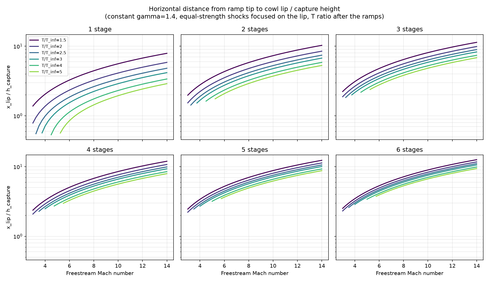
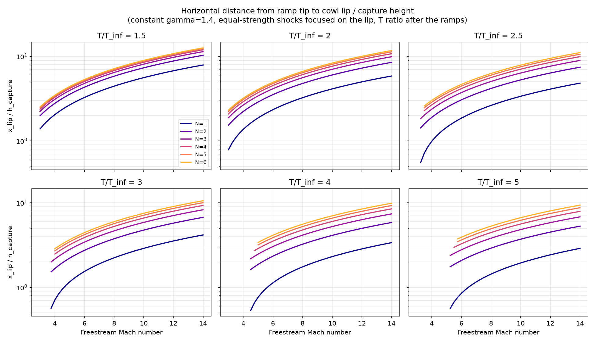

# Eulerインテークの理論形状：ランプ先端からリップ先端までの水平距離

2026年10月27日計算。多段ランプの理論形状設計（`scripts/intake_design.py`、説明文書は非公開）で、ランプ先端からカウルのリップ先端までの水平距離 x_lip を捕獲高さ h_c で無次元化し、入口Mach数・温度比・段数に対して求めた。理論形状の計算で、CFDは行っていない。

## 結論

- x_lip/h_c は、Mach数が高いほど、段数が多いほど長く、温度比が高いほど短い。Mach 10・温度比2.5では1段3.37、2段5.27、4段7.05、6段7.88。
- リップは第1衝撃波の上にあるので、x_lip/h_c = cot β₁（β₁は第1衝撃波の角度）。等強度配分では第1段の温度比が R^(1/N) なので、x_lip/h_c は Mach数と R^(1/N) だけで決まる。例えばMach 10で、1段・R=2と2段・R=4はともに4.12、2段・R=2と4段・R=4はともに6.02。
- 段数を増やすと伸び方は小さくなる。Mach 10・R=2.5で、1→2段で+1.90、5→6段で+0.35。R^(1/N)→1でβ₁はMach角に近づき、x_lip/h_c は √(M²−1)（Mach 10で9.95）に近づく。
- [10月24日の掃引](../20261024-intake-sweep-mach10/report.md)の形状（Mach 10・R=2.5、捕獲高さ1 m）の値は、2段5.27、4段7.05。
- 低Machで温度比が高いと設計が成立しない（下の表）。

## 共通条件

| 項目 | 内容 |
|---|---|
| 設計 | `intake_design.design()`。定比熱、γ=1.4、二次元、付着した弱い斜め衝撃波、等強度配分（各段の温度比 R^(1/N)）、全衝撃波をリップ先端へ集約（shock-on-lip） |
| 温度比 R | 最終ランプの衝撃波直後の静温÷入口静温（`temperature_location=after_ramps`）。カウル衝撃波は含まない |
| 距離 | ランプ先端（第1ランプの始点、原点）からリップ先端までの水平距離。捕獲高さ（ランプ先端からリップ先端までの鉛直距離）で割る。形状は相似なので h_c=1 で計算した |
| 掃引 | Mach 3〜14（0.25刻み、45点）× R = 1.5、2、2.5、3、4、5 × 段数 N = 1〜6。計1620点 |
| 検査 | 全点で x_lip/h_c × tan β₁ = 1（誤差1e-9未満）を確認した |

## 結果

Mach 10での x_lip/h_c：

| 段数 N | R=1.5 | R=2 | R=2.5 | R=3 | R=4 | R=5 |
|---|---|---|---|---|---|---|
| 1 | 5.60 | 4.12 | 3.37 | 2.90 | 2.31 | 1.95 |
| 2 | 7.32 | 6.02 | 5.27 | 4.76 | 4.12 | 3.72 |
| 3 | 8.09 | 7.03 | 6.35 | 5.88 | 5.24 | 4.83 |
| 4 | 8.52 | 7.64 | 7.05 | 6.62 | 6.02 | 5.62 |
| 5 | 8.79 | 8.05 | 7.53 | 7.14 | 6.60 | 6.22 |
| 6 | 8.97 | 8.34 | 7.88 | 7.53 | 7.03 | 6.68 |

全点の値は [lip-distance.csv](lip-distance.csv)（1行1点。x_lip/h_c、第1衝撃波の角度、ランプ群通過後の理論全圧回復率、不成立の理由）。

段数ごと（線は温度比）：



温度比ごと（線は段数）：



縦軸は対数。

## 設計が成立しない範囲

各組の成立する最低Mach数（掃引の刻み0.25での値）。これより低いMachでは、衝撃波の下流が音速以下になる（"Target requires sonic or subsonic downstream flow"）か、4段以上で後段のランプ・衝撃波が前向きにならない（"Stage k: no forward-facing ramp / shock geometry"）。

| 段数 N | R=1.5 | R=2 | R=2.5 | R=3 | R=4 | R=5 |
|---|---|---|---|---|---|---|
| 1〜3 | 3.0以下 | 3.0以下 | 3.25 | 3.75 | 4.5 | 5.25 |
| 4 | 3.0以下 | 3.0以下 | 3.5 | 4.0 | 4.75 | 5.5 |
| 5、6 | 3.0以下 | 3.0以下 | 3.5 | 4.0 | 5.0 | 5.75 |

## 注意

- 理論形状の値で、CFDでの衝撃波位置を示すものではない。迎角やMach数が設計点から外れると衝撃波はリップに集まらない。
- 段数を増やすと全圧回復率は上がるが、ランプ全長も伸びる。摩擦・加熱・始動性を含めた最適化ではない。
- 実在気体（NASA7）や、カウル衝撃波通過後の温度比（`after_cowl`）では値が変わる。

## 再現

リポジトリの最上位で次を実行する（numpy、matplotlib が必要）。`lip-distance.csv` と `figures/` の図を上書きする。

```sh
python docs/reports/20261027-intake-lip-distance/lip_distance.py
```
